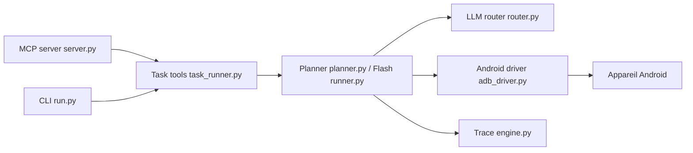

# google/artemis

> Agent qui pilote de vrais téléphones Android en langage naturel, pour tests mobiles et assistants IDE via MCP.

## Le problème
Tester ou utiliser une application Android demande de scripter chaque écran ; un agent doit voir l'interface et agir comme un humain.

## Ce que ça fait vraiment
Observe l'écran (arbre d'accessibilité, OCR, modèles visuels) et agit par ADB. Deux profils : Flash (boucle réactive, 3 à 5 s par étape) et Pro (graphe multi-agents avec Planner, Operator, Checker). Exposé par CLI, console web, serveur MCP (pour Antigravity, Claude Code, Windsurf…) et SDK Python. Installe sur le téléphone un petit service d'accessibilité.

## Comment c'est branché


## Essayer
```bash
git clone https://github.com/google/artemis.git && cd artemis
./start.sh
uv run artemis run "Open Settings, find Battery and tell me current level" --profile flash
uv run artemis mcp --install antigravity
```

## Coût et pièges
Le script installe ADB, scrcpy, FFmpeg et dépendances `uv`, puis propose d'écrire dans les configurations de tes IDE. Il faut un fournisseur LLM (clé à ta charge) et un téléphone avec débogage USB. Un service d'accessibilité est déployé sur l'appareil à la première tâche.

## Ce que ce n'est pas
Pas un framework de test déterministe : le résultat dépend du modèle. Le score « 99 %+ sur AndroidWorld » est une affirmation du README, sans méthode détaillée. Flash n'a ni plan, ni vérification finale.

## Alternatives
Aucune alternative nommée dans le README (il intègre du code de mobile-use de Minitap, sous Apache 2.0).

## Pour toi
À surveiller : très pertinent pour tester des applications mobiles avec un agent, mais jeune (créé en août 2026) et couplé à un LLM tiers.

