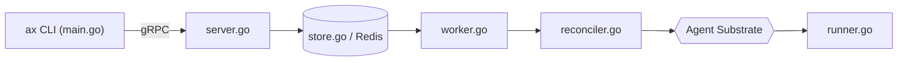

# google/ax

> Declarative kubectl-style orchestrator for launching sandboxed agent tasks on Kubernetes.

## The problem
An agent is neither a stateless microservice nor a batch job: it accumulates state, requires isolation, calls model APIs and can burn through budget in a loop with nobody watching.

## What it actually does
Three `ax.io/v1alpha1` manifests: `Task` (sandbox with CPU/memory limits), `Workspace` (Git repositories, MCP servers, pre-wired skills), `Model` (LLM and credentials pulled from a Kubernetes secret).
The CLI talks gRPC to the control plane; the API stores resources in Redis, a worker reconciles each task into an actor on Agent Substrate.
Inside the container, a runner prepares the workspace and serves the task metadata.
Agent-specific verbs: `ax suspend` / `ax resume` (checkpoint), `ax ssh` into the sandbox, `ax watch`.

## How it is wired


## Trying it
```bash
kubectl get svc api -n ate-system
go install github.com/google/ax/cmd/ax@latest
make deploy AX_IMAGE_REPO=<your-registry>
ax apply -f examples/task.yaml
ax get tasks
ax watch task task123
ax ssh task123 -- ls -la /workspace
```

## Cost and gotchas
You need a Kubernetes cluster with Agent Substrate already installed, Go, `kubectl`, `ko` and an image registry reachable by the cluster. Model calls (Gemini in the example) are at your expense.

## What it is not
Not an agent framework: it hosts and isolates, it does not write the agent's logic.
Not stable: the README announces major breaking changes before the stable version.
Not a workstation tool: without a cluster, nothing runs.

## Alternatives
No alternative named in the README.

## For you
Worth following if you run agents in numbers on Kubernetes; too early to commit to it.
