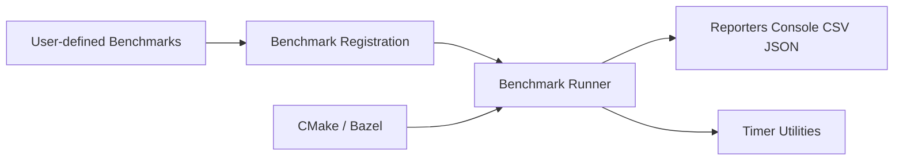

# google/benchmark

> C++ micro-benchmark library, used like unit tests, for C++ developers.

## The problem
Cleanly measure the execution time of C++ code fragments without rewriting timing loops.

## What it actually does
You write a function that takes a `benchmark::State`, register it with `BENCHMARK`, then a runner launches it and reporters output to the console, CSV or JSON. It also provides Python bindings and comparison tools.

## How it is wired


## Trying it
```bash
git clone https://github.com/google/benchmark.git
cd benchmark
cmake -E make_directory "build"
cmake -DBENCHMARK_DOWNLOAD_DEPENDENCIES=on -DCMAKE_BUILD_TYPE=Release -S . -B "build"
cmake --build "build" --config Release
```

## Cost and gotchas
Free. Built in C++17; by default the library builds in debug (with a warning): remember `Release`. Google Test is required for the tests.

## What it is not
Not a profiler; it measures isolated fragments. The `v2` branch is experimental, with no stability guarantee.

## Alternatives
No alternative named in the README.

## For you
Ignore: it is low-level C++; useful only if you optimize C++ code behind your models.
