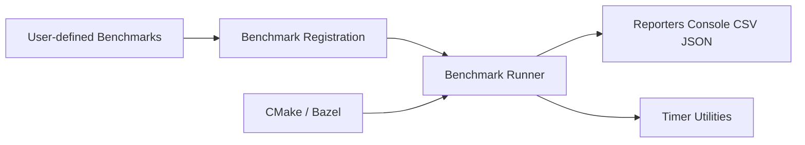

# google/benchmark

> Bibliothèque C++ de micro-benchmarks, utilisée comme des tests unitaires, pour développeurs C++.

## Le problème
Mesurer proprement le temps d'exécution de fragments de code C++ sans réécrire de boucles de chronométrage.

## Ce que ça fait vraiment
Tu écris une fonction qui prend un `benchmark::State`, tu l'enregistres avec `BENCHMARK`, puis un exécuteur la lance et des rapporteurs sortent la console, CSV ou JSON. Fournit aussi des liaisons Python et des outils de comparaison.

## Comment c'est branché


## Essayer
```bash
git clone https://github.com/google/benchmark.git
cd benchmark
cmake -E make_directory "build"
cmake -DBENCHMARK_DOWNLOAD_DEPENDENCIES=on -DCMAKE_BUILD_TYPE=Release -S . -B "build"
cmake --build "build" --config Release
```

## Coût et pièges
Gratuit. Compilation en C++17 ; par défaut la bibliothèque se construit en debug (avertissement) : penser à `Release`. Google Test requis pour les tests.

## Ce que ce n'est pas
Pas un profileur ; il mesure des fragments isolés. La branche `v2` est expérimentale, sans garantie de stabilité.

## Alternatives
Aucune alternative nommée dans le README.

## Pour toi
À ignorer : c'est du C++ bas niveau ; utile seulement si tu optimises du code C++ derrière tes modèles.

