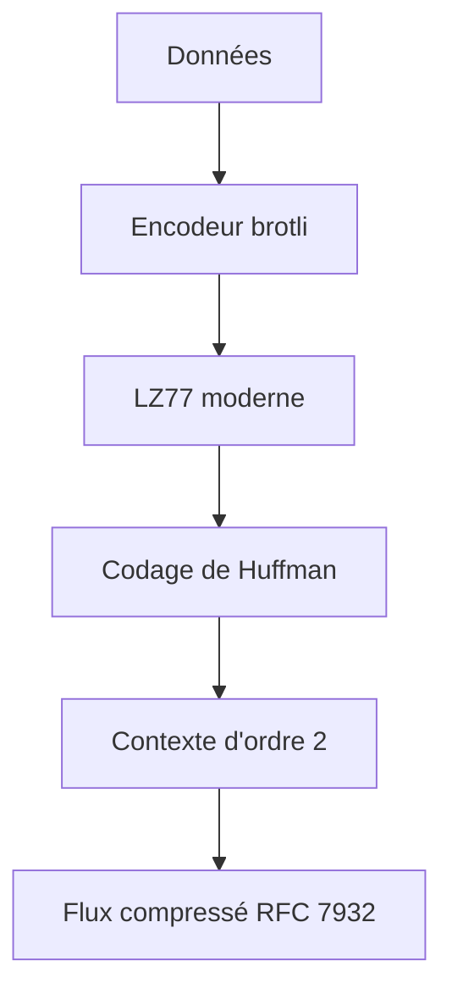

# google/brotli

> Lossless compression algorithm and library, denser than deflate, for developers and administrators.

## The problem
Text files, web pages or datasets compressed with deflate take up more space than necessary.

## What it actually does
Combines a variant of LZ77, Huffman coding and order-2 context modeling. Speed comparable to deflate, denser compression. Format defined by RFC 7932. Provides a command-line tool, a C library and a Python module. Streaming format: no checksum and no original size.

## How it is wired
Simplified diagram based on the sheet, no diagram provided.


## Trying it
```bash
apt install brotli
brew install brotli
pip install brotli
```

## Cost and gotchas
Free. The stream has no integrity check: a modification of the raw range is not detected by the decoder, so plan your own checksum.

## What it is not
It is not an archive format (no metadata or file list). The third-party projects listed in the README are not guaranteed by the authors.

## Alternatives
No alternative named in the README (deflate is cited as a point of comparison).

## For you
Adopt: compress text datasets or artifacts to be served, with an installation via `pip install brotli`.
