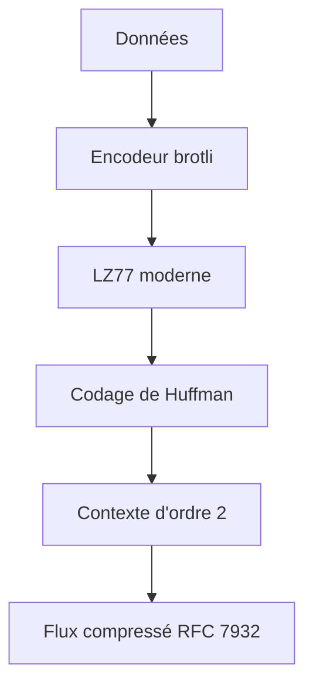

# google/brotli

> Algorithme et bibliothèque de compression sans perte, plus dense que deflate, pour développeurs et administrateurs.

## Le problème
Les fichiers texte, pages web ou jeux de données compressés avec deflate occupent plus de place que nécessaire.

## Ce que ça fait vraiment
Combine une variante de LZ77, un codage de Huffman et une modélisation de contexte d'ordre 2. Vitesse comparable à deflate, compression plus dense. Format défini par la RFC 7932. Fournit un outil en ligne de commande, une bibliothèque C et un module Python. Format en flux : sans somme de contrôle ni taille d'origine.

## Comment c'est branché
Schéma simplifié d'après la fiche, sans diagramme fourni.


## Essayer
```bash
apt install brotli
brew install brotli
pip install brotli
```

## Coût et pièges
Gratuit. Le flux n'a pas de contrôle d'intégrité : une modification de la plage brute n'est pas détectée par le décodeur, donc prévoir ta propre somme de contrôle.

## Ce que ce n'est pas
Ce n'est pas un format d'archive (pas de métadonnées ni de liste de fichiers). Les projets tiers listés dans le README ne sont pas garantis par les auteurs.

## Alternatives
Aucune alternative nommée dans le README (deflate est cité comme point de comparaison).

## Pour toi
À adopter : compresser des jeux de données texte ou des artefacts à servir, avec une installation en `pip install brotli`.

