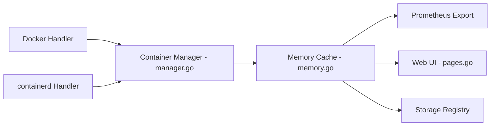

# google/cadvisor

> Daemon that collects and exposes resource usage and performance of running containers.

## The problem
Knowing what containers actually consume (CPU, memory, network, disk) on a machine.

## What it actually does
A daemon discovers containers (Docker, Podman, containerd, CRI-O, raw), keeps the usage history and serves it via a web interface, a versioned REST API, a Prometheus endpoint and storage drivers (including BigQuery). Optional perf and resctrl metrics; official Go client; deployable as a Kubernetes DaemonSet.

## How it is wired


## Trying it
```bash
VERSION=0.55.1
sudo docker run \
  --volume=/:/rootfs:ro \
  --volume=/var/run:/var/run:ro \
  --volume=/sys:/sys:ro \
  --volume=/var/lib/docker/:/var/lib/docker:ro \
  --volume=/dev/disk/:/dev/disk:ro \
  --publish=8080:8080 --detach=true --name=cadvisor \
  --privileged --device=/dev/kmsg \
  ghcr.io/google/cadvisor:$VERSION
```

## Cost and gotchas
Free. The container runs `--privileged` and mounts system directories read-only. Specific instructions for CentOS, Fedora, RHEL.

## What it is not
Not a complete monitoring solution: no alerts and no long-term storage without an external backend. License not identified by GitHub.

## Alternatives
No alternative named in the README.

## For you
Adopt to expose container metrics to Prometheus (training jobs, inference servers): lean, proven and maintained by an active team.
