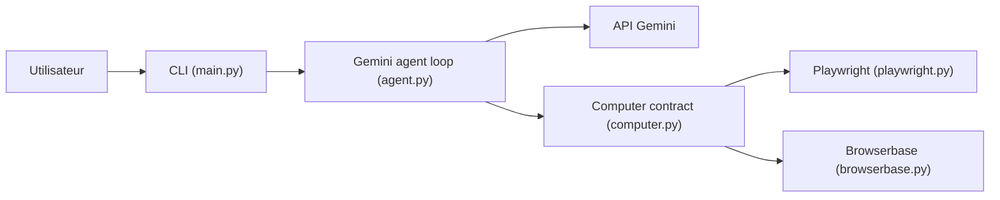

# google/computer-use-preview

> Command-line example of a browser agent driven by Gemini, to test the "computer use" API.

## The problem
Making an LLM act on a web page (click, type, read the screen) requires connecting model, actions and browser.

## What it actually does
- `main.py` receives a natural-language request and loops: Gemini proposes an action, the agent executes it in a browser, and sends a screenshot back to the model.
- Two backends: Playwright (local Chrome) or Browserbase (hosted browser).
- Default model `gemini-3.6-flash`, other Gemini models of your choice.
- Works with the Gemini API (key) or Vertex AI.

## How it is wired


## Trying it
```bash
git clone https://github.com/google-gemini/computer-use-preview.git
cd computer-use-preview
python3 -m venv .venv && source .venv/bin/activate
pip install -r requirements.txt
playwright install chrome
export GEMINI_API_KEY="YOUR_GEMINI_API_KEY"
python main.py --query "Go to Google and type 'Hello World' into the search bar" --env playwright
```

## Cost and gotchas
Gemini key (or Vertex AI project) billed to you; Browserbase requires a key and a project. Known limitation: native dropdown lists are not captured by Playwright on some OSes.

## What it is not
Not a product: a demonstration "preview", tied to Gemini models. No documented safeguard on what the agent can do on the web.

## Alternatives
No alternative named in the README.

## For you
Watch: a good starting point to understand a browser agent loop, but a prototype and dependent on Gemini.
