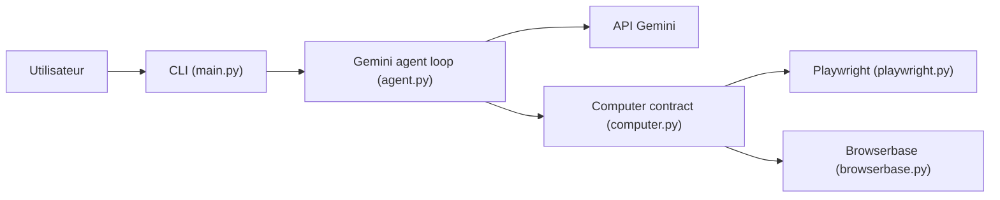

# google/computer-use-preview

> Exemple en ligne de commande d'un agent navigateur piloté par Gemini, pour tester l'API « computer use ».

## Le problème
Faire agir un LLM sur une page web (cliquer, taper, lire l'écran) demande de relier modèle, actions et navigateur.

## Ce que ça fait vraiment
- `main.py` reçoit une requête en langage naturel et boucle : Gemini propose une action, l'agent l'exécute dans un navigateur, renvoie une capture au modèle.
- Deux backends : Playwright (Chrome local) ou Browserbase (navigateur hébergé).
- Modèle par défaut `gemini-3.6-flash`, autres modèles Gemini au choix.
- Fonctionne avec l'API Gemini (clé) ou Vertex AI.

## Comment c'est branché


## Essayer
```bash
git clone https://github.com/google-gemini/computer-use-preview.git
cd computer-use-preview
python3 -m venv .venv && source .venv/bin/activate
pip install -r requirements.txt
playwright install chrome
export GEMINI_API_KEY="YOUR_GEMINI_API_KEY"
python main.py --query "Go to Google and type 'Hello World' into the search bar" --env playwright
```

## Coût et pièges
Clé Gemini (ou projet Vertex AI) facturée à ta charge ; Browserbase demande clé et projet. Limite connue : les listes déroulantes natives ne sont pas capturées par Playwright sur certains OS.

## Ce que ce n'est pas
Pas un produit : un « preview » de démonstration, lié aux modèles Gemini. Pas de garde-fou documenté sur ce que l'agent peut faire sur le web.

## Alternatives
Aucune alternative nommée dans le README.

## Pour toi
À surveiller : bon point de départ pour comprendre une boucle d'agent navigateur, mais prototype et dépendant de Gemini.

