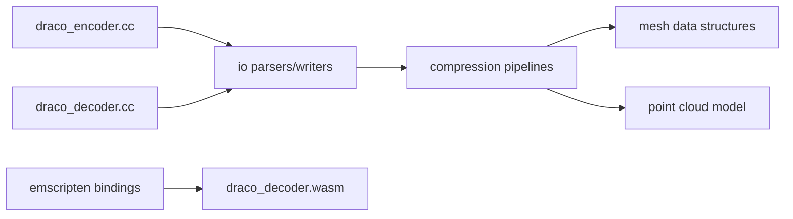

# google/draco

> C++ library for compressing 3D meshes and point clouds, with Wasm and JavaScript decoders.

## The problem
3D models and point clouds are heavy to store and transmit, especially on the web.

## What it actually does
It encodes and decodes meshes and point clouds, with per-attribute quantization and compression levels. The `draco_encoder`, `draco_decoder` and `draco_transcoder` (glTF) tools are provided, along with Wasm and JavaScript decoders, Unity and Maya plugins and a metadata API.

## How it is wired


## Trying it
```bash
./draco_encoder -i testdata/bun_zipper.ply -o out.drc
./draco_encoder -i testdata/bun_zipper.ply -o out.drc -qp 14
./draco_decoder -i in.drc -o out.obj
./draco_transcoder -i in.glb -o out.glb
```

## Cost and gotchas
Free. Built with CMake. Web decoders must be loaded from versioned gstatic URLs, otherwise transient cache errors occur.

## What it is not
Not a general-purpose compressor: it only handles 3D geometry. Compression is lossy as soon as you quantize.

## Alternatives
No alternative named in the README.

## For you
Worth watching: useful if you handle point clouds or 3D meshes for vision, otherwise off topic.
