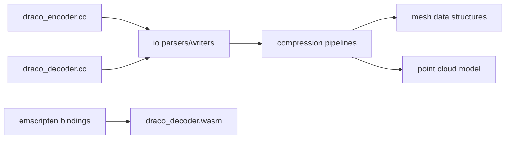

# google/draco

> Bibliothèque C++ de compression de maillages 3D et de nuages de points, avec décodeurs Wasm et JavaScript.

## Le problème
Les modèles 3D et nuages de points sont lourds à stocker et à transmettre, surtout sur le web.

## Ce que ça fait vraiment
Elle encode et décode maillages et nuages de points, avec quantification par attribut et niveaux de compression. Les outils `draco_encoder`, `draco_decoder` et `draco_transcoder` (glTF) sont fournis, ainsi que des décodeurs Wasm et JavaScript, des plugins Unity et Maya et une API de métadonnées.

## Comment c'est branché


## Essayer
```bash
./draco_encoder -i testdata/bun_zipper.ply -o out.drc
./draco_encoder -i testdata/bun_zipper.ply -o out.drc -qp 14
./draco_decoder -i in.drc -o out.obj
./draco_transcoder -i in.glb -o out.glb
```

## Coût et pièges
Gratuit. Compilation avec CMake. Les décodeurs web doivent être chargés depuis des URL versionnées de gstatic, sinon erreurs transitoires de cache.

## Ce que ce n'est pas
Ce n'est pas un compresseur général : il ne traite que la géométrie 3D. La compression est avec perte dès qu'on quantifie.

## Alternatives
Aucune alternative nommée dans le README.

## Pour toi
À surveiller : utile si tu manipules des nuages de points ou des maillages 3D pour de la vision, sinon hors sujet.

