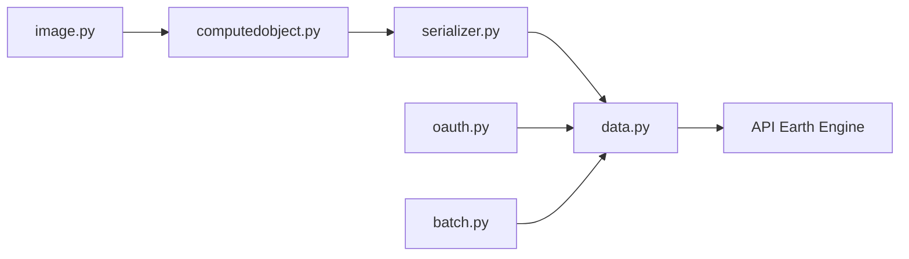

# google/earthengine-api

> Python and JavaScript clients for computing on Google Earth Engine geospatial data.

## The problem
Processing planet-scale satellite archives is impossible on a local machine.

## What it actually does
You compose operations on images and collections; the client serializes the expression, sends it to the Earth Engine API, then retrieves the results, exports or tiles. OAuth authentication, batch tasks, command line, tile client. The computation happens on Google's servers.

## How it is wired

## Trying it
No command documented in the README (it points to the Python installation page). A JavaScript Code Editor example is provided (nighttime lights trend).

## Cost and gotchas
An Earth Engine account is required; the pricing plan is not detailed in the README. Bugs are reported on the Google Issue Tracker, not on GitHub.

## What it is not
Not a local engine: without the Google service, nothing runs.

## Alternatives
None cited in the README.

## For you
A reference for Earth observation and raster time series: adopt it if you do geo work, accepting the dependency on Google.
