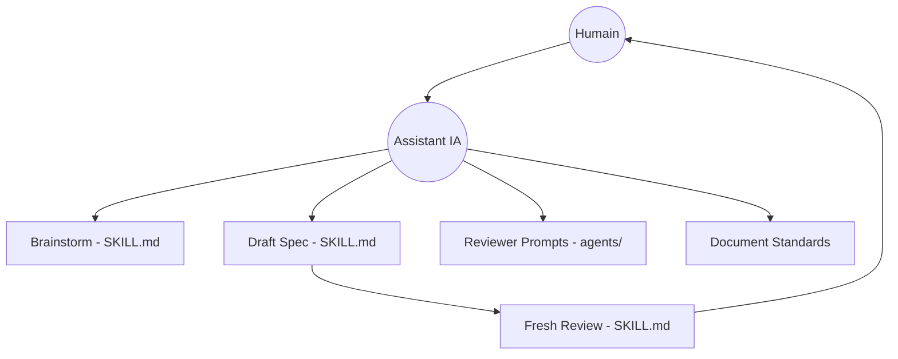

# google/elephant-goldfish-model

> Plugin for coding assistants that drafts specifications then has them reviewed by context-free reviewers.

## The problem
An agent that drafts and reviews its own design keeps its blind spots and implicit assumptions.

## What it actually does
Eight skills: brainstorm, draft, resolve, bootstrap, lite, review (five steps), review-loop and drift-report. "Elephant" keeps the project context and drafts; "Goldfish" reviews in a fresh context thanks to sub-agents; the human decides. The drift report compares versioned documents with the current code.

## How it is wired


## Trying it
```bash
claude plugin marketplace add google/elephant-goldfish-model
claude plugin install egm@egm
```
Then, in the agent: `/egm:egm-review docs/designs/webhooks.md` or `/egm:egm-drift-report docs/designs/`.

## Cost and gotchas
Free, but each review launches several sub-agents: token consumption depends on your subscription. Without fresh-context sub-agents, the review stops. Version agy 1.4.8 requires the `/egm:` prefix.

## What it is not
Not a replacement for tests or human judgment (the README says so). Not a code generator: it produces and critiques specifications.

## Alternatives
No alternative named in the README.

## For you
Useful to validate an ML design doc or an architecture before coding; to watch to measure the real token cost.
