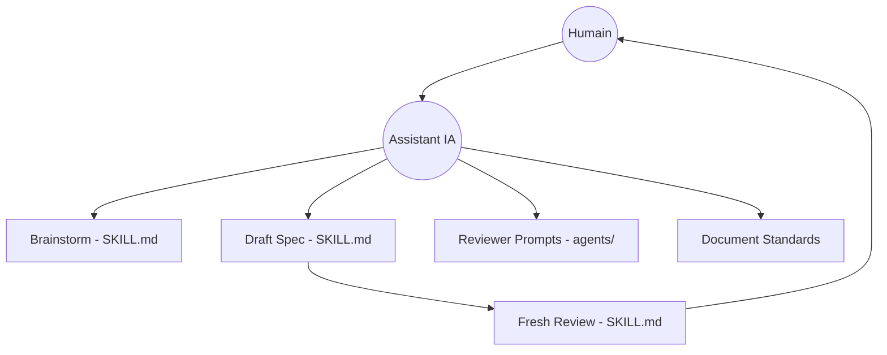

# google/elephant-goldfish-model

> Plugin pour assistants de code qui rédige des spécifications puis les fait relire par des reviewers sans contexte.

## Le problème
Un agent qui rédige et relit sa propre conception garde ses angles morts et ses hypothèses implicites.

## Ce que ça fait vraiment
Huit skills : brainstorm, draft, resolve, bootstrap, lite, review (cinq étapes), review-loop et drift-report. « Elephant » garde le contexte du projet et rédige ; « Goldfish » relit dans un contexte neuf grâce à des sous-agents ; l'humain tranche. Le rapport de dérive compare des documents versionnés au code actuel.

## Comment c'est branché


## Essayer
```bash
claude plugin marketplace add google/elephant-goldfish-model
claude plugin install egm@egm
```
Puis, dans l'agent : `/egm:egm-review docs/designs/webhooks.md` ou `/egm:egm-drift-report docs/designs/`.

## Coût et pièges
Gratuit, mais chaque relecture lance plusieurs sous-agents : la consommation de tokens dépend de ton abonnement. Sans sous-agents à contexte neuf, la revue s'arrête. La version agy 1.4.8 exige le préfixe `/egm:`.

## Ce que ce n'est pas
Pas un remplaçant des tests ni du jugement humain (le README le dit). Pas un générateur de code : il produit et critique des spécifications.

## Alternatives
Aucune alternative nommée dans le README.

## Pour toi
Utile pour valider un design doc ML ou une architecture avant de coder ; à surveiller pour mesurer le coût réel en tokens.

