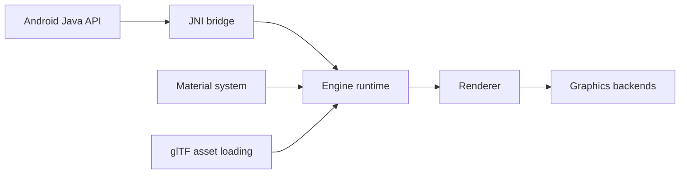

# google/filament

> Real-time physically based 3D rendering engine for Android, iOS, desktop and WebAssembly.

## The problem
Display realistic 3D on mobile and web without a heavy engine.

## What it actually does
Lightweight engine: `Engine`, `Renderer`, `SwapChain`, `View`, `Scene`, `Camera`. Materials compiled by `matc`, glTF 2.0 loading, image-based lighting, shadows, post-processing (bloom, depth of field, TAA), OpenGL, Metal, Vulkan, WebGPU and WebGL 2 backends. C++, Java/JNI and JavaScript APIs.

## How it is wired


## Trying it
```gradle
dependencies {
    implementation 'com.google.android.filament:filament-android:1.78.1'
}
```
iOS: `pod 'Filament', '~> 1.78.1'`

## Cost and gotchas
Free. You must use the tools (`matc`) of the same version as the library. Not officially supported by Google, the README says.

## What it is not
Not a game engine or an editor: a rendering library.

## Alternatives
None named in the README.

## For you
Ignore: 3D rendering, outside your data / AI scope.
