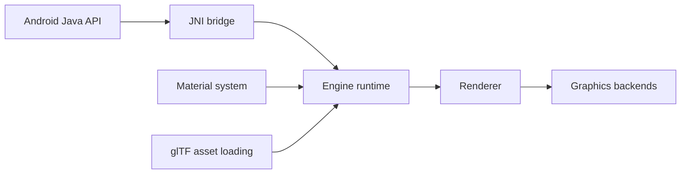

# google/filament

> Moteur de rendu 3D temps réel à base physique pour Android, iOS, desktop et WebAssembly.

## Le problème
Afficher du 3D réaliste sur mobile et web sans moteur lourd.

## Ce que ça fait vraiment
Moteur léger : `Engine`, `Renderer`, `SwapChain`, `View`, `Scene`, `Camera`. Matériaux compilés par `matc`, chargement glTF 2.0, éclairage par image, ombres, post-traitement (bloom, profondeur de champ, TAA), backends OpenGL, Metal, Vulkan, WebGPU, WebGL 2. API C++, Java/JNI, JavaScript.

## Comment c'est branché


## Essayer
```gradle
dependencies {
    implementation 'com.google.android.filament:filament-android:1.78.1'
}
```
iOS : `pod 'Filament', '~> 1.78.1'`

## Coût et pièges
Gratuit. Il faut utiliser les outils (`matc`) de la même version que la bibliothèque. Non officiellement supporté par Google, dit le README.

## Ce que ce n'est pas
Pas un moteur de jeu ni un éditeur : une bibliothèque de rendu.

## Alternatives
Aucune nommée dans le README.

## Pour toi
Ignorer : du rendu 3D, hors de ton périmètre data / IA.

