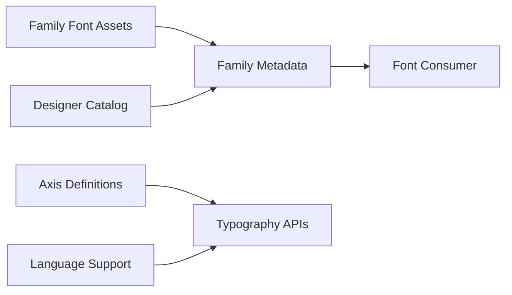

# google/fonts

> Binary font files served by Google Fonts, with metadata and language data.

## The problem
Getting the Google Fonts fonts to self-host them, with their metadata.

## What it actually does
One folder per family (`.ttf`, `METADATA.pb`, `DESCRIPTION.en_us.html`), sorted by license at the top level. `/catalog` (designer profiles), `/axisregistry` and `/lang` (subtrees coming from elsewhere: do not modify them here). A full ZIP archive exceeds 1 GB.

## How it is wired

## Trying it
No command in the README: sync with git, download the ZIP, or go through Fontsource or `fnt`.

## Cost and gotchas
Free; very large repository. No license at the repository level: each top-level folder states the license of the fonts it contains.

## What it is not
Not a delivery service: these are the files, not the Google Fonts server.

## Alternatives
Fontsource (npm packages) and `fnt` (local installation), cited in the README.

## For you
Ignore: useful only if you need fonts (charts, reports), with no data / AI value of its own.
