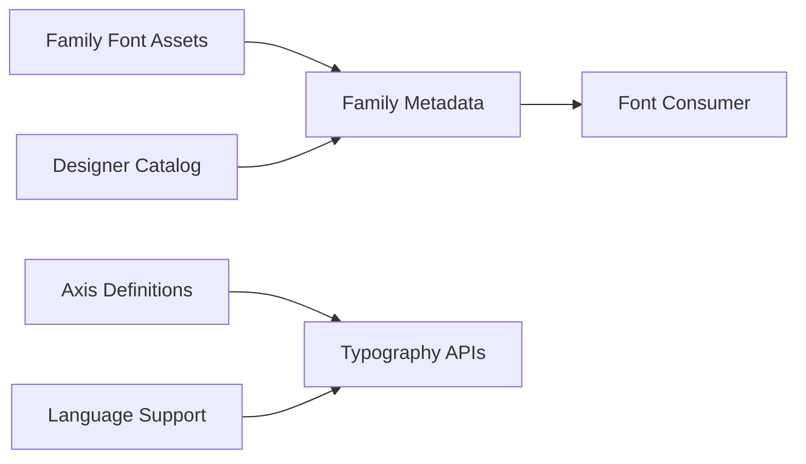

# google/fonts

> Fichiers binaires de polices servis par Google Fonts, avec métadonnées et données de langues.

## Le problème
Obtenir les polices de Google Fonts pour les héberger soi-même, avec leurs métadonnées.

## Ce que ça fait vraiment
Un dossier par famille (`.ttf`, `METADATA.pb`, `DESCRIPTION.en_us.html`), classé par licence au niveau supérieur. `/catalog` (profils des designers), `/axisregistry` et `/lang` (sous-arbres venant d'ailleurs : ne pas les modifier ici). Une archive ZIP complète dépasse 1 Go.

## Comment c'est branché

## Essayer
Aucune commande dans le README : synchroniser avec git, télécharger le ZIP, ou passer par Fontsource ou `fnt`.

## Coût et pièges
Gratuit ; dépôt très volumineux. Pas de licence au niveau du dépôt : chaque dossier de premier niveau indique la licence des polices qu'il contient.

## Ce que ce n'est pas
Pas un service de diffusion : ce sont les fichiers, pas le serveur Google Fonts.

## Alternatives
Fontsource (paquets npm) et `fnt` (installation locale), cités dans le README.

## Pour toi
Ignorer : utile seulement si tu as besoin de polices (graphiques, rapports), sans valeur data / IA propre.

