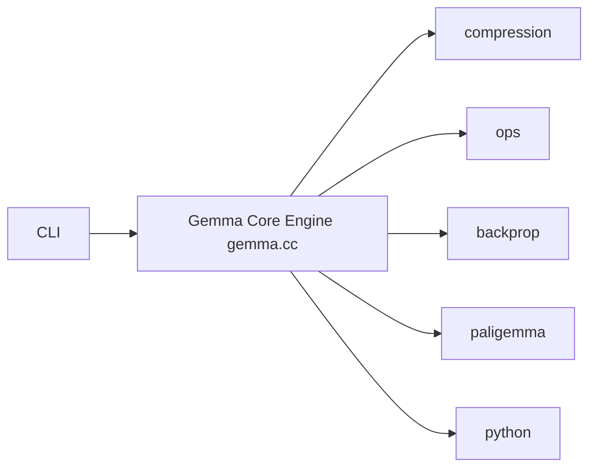

# google/gemma.cpp

> Minimal C++ inference engine for Gemma models on CPU, designed for research and experimentation.

## The problem
Deployment-oriented inference engines are hard to modify, and Python research frameworks hide low-level computation. A readable middle ground for experimenting is missing.

## What it actually does
Implements Gemma 2, Gemma 3 and PaliGemma 2 in C++ with a core of about 2,000 lines. CPU-only inference, TopK and temperature sampling, backward pass and Adam optimizer for research, compressed weights (fp8, bf16, 4-bit non-uniform) and portable SIMD via Highway. Provides an interactive terminal, a C++ API and basic Python bindings.

## How it is wired


## Trying it
```bash
cmake -B build
cmake --preset make
cmake --build --preset make -j 8
./gemma --tokenizer tokenizer.spm --weights gemma2-2b-it-sfp.sbs
```

## Cost and gotchas
Free, but the weights are downloaded from Kaggle or Hugging Face after a consent form. CPU only: speed depends on your machine, `-sfp` weights are recommended. On WSL, limit to 1 build thread.

## What it is not
Not an engine for production deployment: the README points to JAX, Keras, PyTorch and Transformers for that. Image reading is limited to binary PPMs, and conversion from Safetensors is not yet open.

## Alternatives
- ggml, llama.c, llama.rs: cited as inspirations, oriented toward other models.
- JAX, Keras, PyTorch, Transformers: recommended routes for deployment.

## For you
Worth watching: interesting for understanding or tinkering with Gemma inference on CPU, of no interest if you are looking for a model server or GPU.
