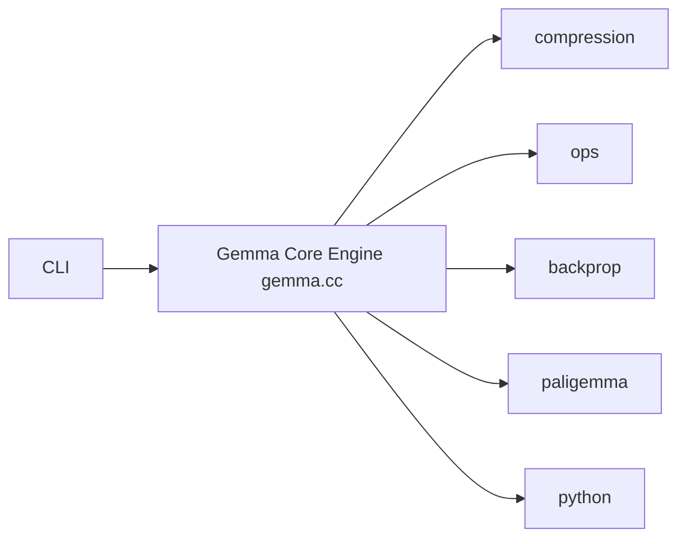

# google/gemma.cpp

> Moteur C++ d'inférence minimal pour les modèles Gemma sur CPU, pensé pour la recherche et l'expérimentation.

## Le problème
Les moteurs d'inférence orientés déploiement sont difficiles à modifier, et les frameworks de recherche en Python cachent le calcul bas niveau. Il manque un entre-deux lisible pour expérimenter.

## Ce que ça fait vraiment
Implémente Gemma 2, Gemma 3 et PaliGemma 2 en C++ avec un cœur d'environ 2 000 lignes. Inférence sur CPU uniquement, échantillonnage TopK et température, passe arrière et optimiseur Adam pour la recherche, poids compressés (fp8, bf16, 4 bits non uniformes) et SIMD portable via Highway. Fournit un terminal interactif, une API C++ et des liaisons Python basiques.

## Comment c'est branché


## Essayer
```bash
cmake -B build
cmake --preset make
cmake --build --preset make -j 8
./gemma --tokenizer tokenizer.spm --weights gemma2-2b-it-sfp.sbs
```

## Coût et pièges
Gratuit, mais les poids se téléchargent sur Kaggle ou Hugging Face après un formulaire de consentement. CPU seulement : la vitesse dépend de ta machine, les poids `-sfp` sont recommandés. Sur WSL, limiter à 1 thread de compilation.

## Ce que ce n'est pas
Pas un moteur pour le déploiement en production : le README renvoie vers JAX, Keras, PyTorch et Transformers pour cela. La lecture d'images se limite aux PPM binaires, et la conversion depuis Safetensors n'est pas encore ouverte.

## Alternatives
- ggml, llama.c, llama.rs : cités comme inspirations, orientés vers d'autres modèles.
- JAX, Keras, PyTorch, Transformers : voies recommandées pour le déploiement.

## Pour toi
À surveiller : intéressant pour comprendre ou bricoler l'inférence de Gemma sur CPU, sans intérêt si tu cherches un serveur de modèles ou du GPU.

