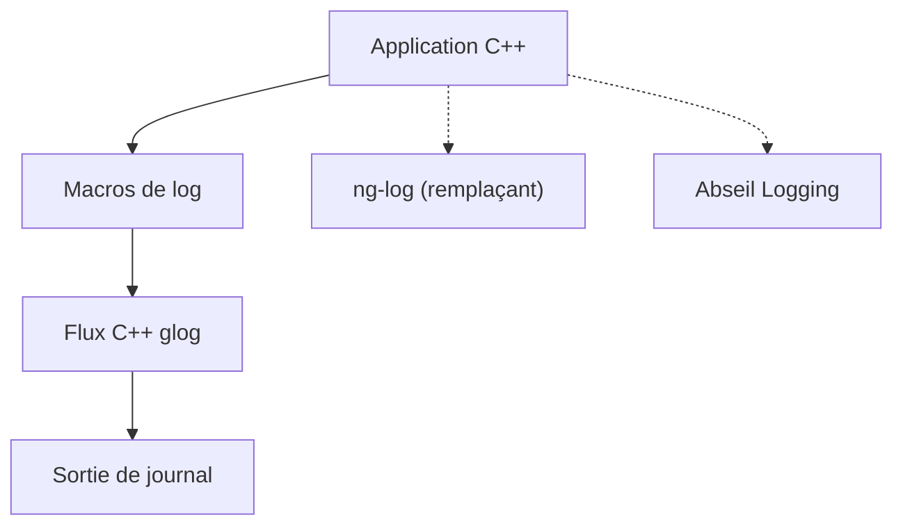

# google/glog

> C++14 application logging library based on streams and macros, now abandoned.

## The problem
C++ code needs simple application logging, with levels and macros.

## What it actually does
Provided logging APIs based on C++ streams and helper macros. The README announces that the project is no longer maintained and will be archived on 2025-06-30. The rest (installation, usage) points to external documentation.

## How it is wired
Simplified diagram based on the fiche, no diagram provided.

## Trying it
No command documented in the README; see the project documentation.

## Cost and gotchas
Free. No more fixes; repository archived, last push in May 2025.

## What it is not
Not a basis for a new project. Nor is it a distributed logging system.

## Alternatives
- ng-log: API-compatible, community-maintained, with migration instructions.
- Abseil Logging: maintained by Google.

## For you
Ignore: abandoned, migrate to ng-log or Abseil Logging if you have C++ code that depends on it.
