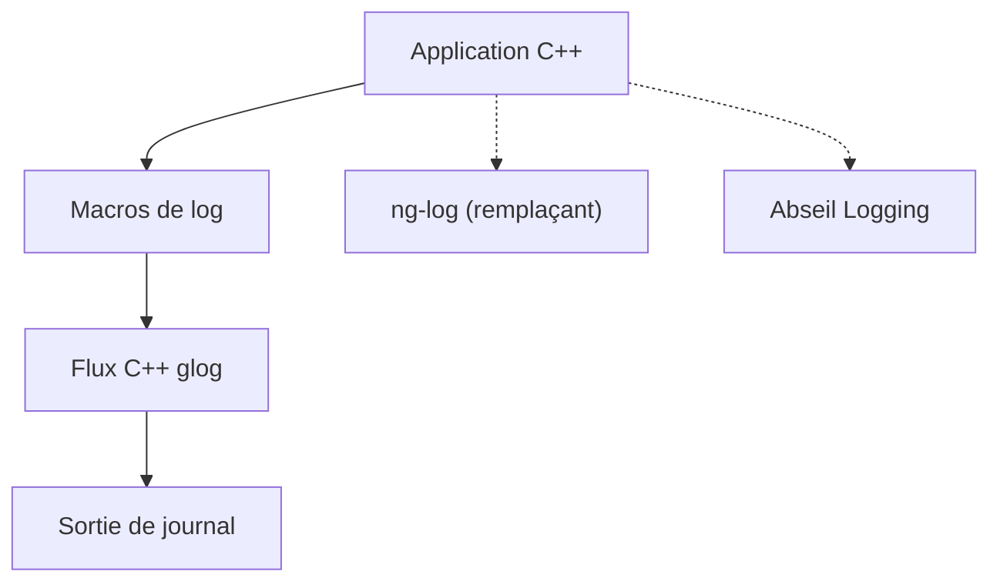

# google/glog

> Bibliothèque C++14 de journalisation applicative par flux et macros, aujourd'hui abandonnée.

## Le problème
Le code C++ a besoin d'une journalisation applicative simple, avec niveaux et macros.

## Ce que ça fait vraiment
Fournissait des API de logging fondées sur les flux C++ et des macros d'aide. Le README annonce que le projet n'est plus maintenu et sera archivé le 2025-06-30. Le reste (installation, usage) renvoie à la documentation externe.

## Comment c'est branché
Schéma simplifié d'après la fiche, sans diagramme fourni.

## Essayer
Aucune commande documentée dans le README ; voir la documentation du projet.

## Coût et pièges
Gratuit. Plus aucun correctif ; dépôt archivé, dernier push en mai 2025.

## Ce que ce n'est pas
Pas une base pour un nouveau projet. Ce n'est pas non plus un système de logs distribué.

## Alternatives
- ng-log : compatible avec l'API, maintenu par la communauté, avec instructions de migration.
- Abseil Logging : maintenu par Google.

## Pour toi
À ignorer : abandonné, migre vers ng-log ou Abseil Logging si tu as du C++ qui en dépend.

