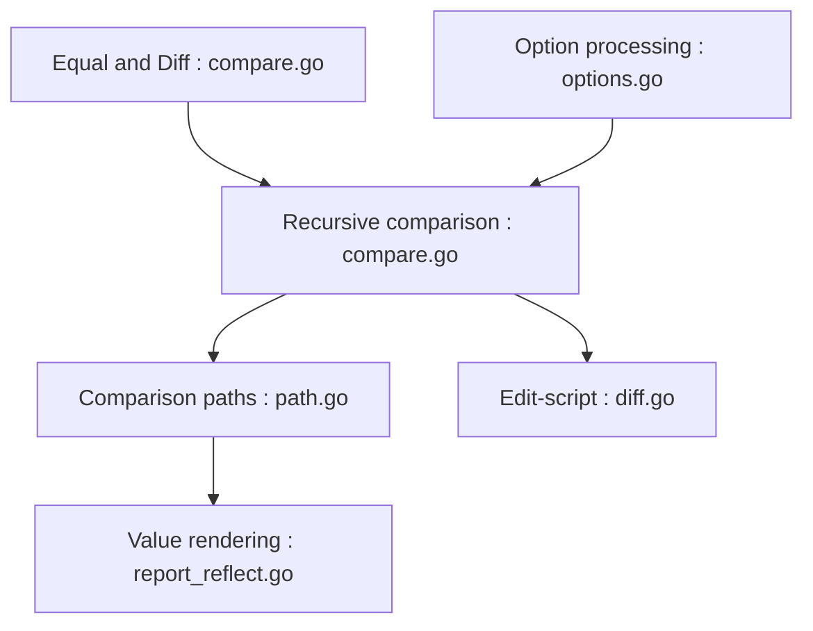

# google/go-cmp

> Go package for comparing values more safely and with more configuration than `reflect.DeepEqual`, mostly in tests.

## The problem
`reflect.DeepEqual` handles neither tolerances nor `Equal` methods, and does not tell you where the difference is.

## What it actually does
`cmp.Equal` compares recursively, using `Equal` methods when they exist or custom equality functions. Unexported fields cause a panic unless they are ignored or explicitly allowed. `cmp.Diff` produces a readable report. The README states that this is not an official Google product.

## How it is wired


## Trying it
```bash
go get -u github.com/google/go-cmp/cmp
```

## Cost and gotchas
Free. The main pitfall is the panic on unexported fields, to be handled with `cmpopts.IgnoreUnexported`.

## What it is not
Not a full testing framework. Go only.

## Alternatives
- reflect.DeepEqual: simpler but less precise, according to the README.

## For you
Worth watching: useful only if you write Go; in that case, it is the reference for comparing cleanly in tests.
