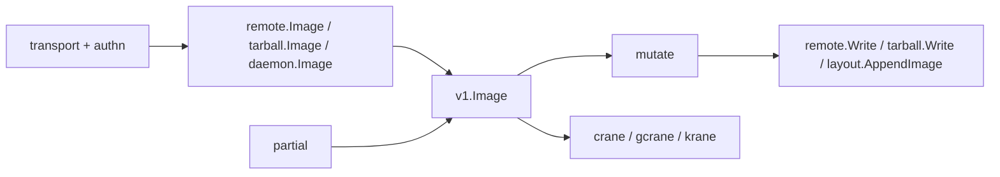

# google/go-containerregistry

> Go library to read, write and transform container images and registries.

## The problem
Manipulating a container image from code forces you to talk to the registry by hand.
Each backend (registry, tarball, daemon, disk) has its own rules.

## What it actually does
Immutable interfaces (`v1.Image`, `v1.Layer`, `v1.ImageIndex`) backed by several media.
Interchangeable sources and sinks: `remote`, `tarball`, `daemon`, `layout`, `random`, `stream`.
The `mutate` package produces new immutable views from an existing image.
The `partial` package avoids implementing the whole interface; `transport` and `authn` provide raw registry access.

## How it is wired

## Trying it
No command documented in the README: it describes the packages and the tools, not the installation.

## Cost and gotchas
Free. Registry access requires authentication: `authn`, or `k8schain` for Kubernetes identities.
Views can be lazy or memoized: the network cost is not where you expect it.

## What it is not
Not a command-line tool, even though `crane`, `gcrane` and `krane` are hosted here.
Not a container runtime: nothing is executed.
`ko`, born here, now lives in its own repository.

## Alternatives
`crane` for command-line use, `gcrane` for GCR, `krane` for Kubernetes identities.

## For you
Useful only if you write Go that pushes or pulls images; otherwise `crane` is what you want.
