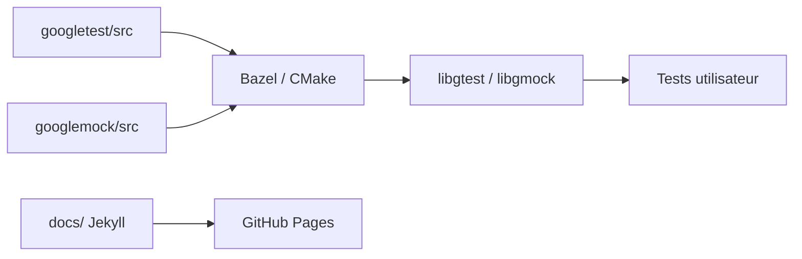

# google/googletest

> Unit testing and mocking framework for C++17, used by Chromium and LLVM.

## The problem
Writing C++ tests without a standard framework forces you to improvise assertions, discovery and execution.

## What it actually does
GoogleTest (xUnit) and GoogleMock together. Automatic test discovery, rich and customizable assertions, death tests, fatal and non-fatal failures, value- and type-parameterized tests, run options. Built with Bazel or CMake. The 1.18.x branch requires C++17; a dependency on Abseil is planned.

## How it is wired

## Trying it
The README contains no command: it points to the user guide, the "Primer" and `googletest/README.md`.

## Cost and gotchas
Free. Continuous integration runs on Google's internal systems, not publicly visible. Requires C++17 since 1.18.

## What it is not
Not a testing tool for Python or for ML models.

## Alternatives
No alternative named in the README (third-party runners are listed: gtest-parallel, GTest Runner).

## For you
Ignore: it concerns C++; useful only if you develop native extensions (for example for computation libraries).
