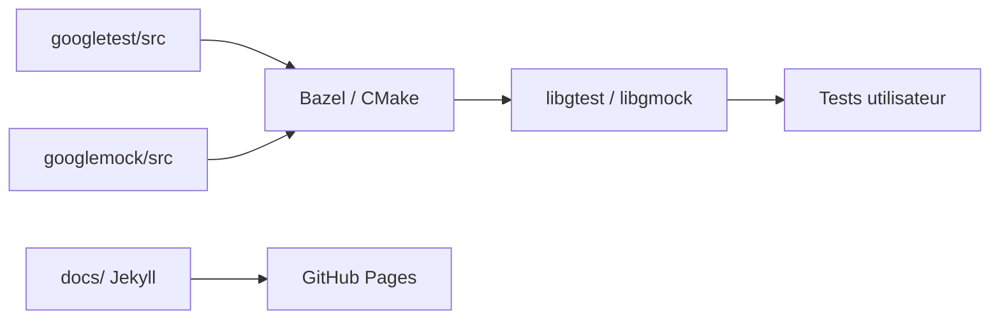

# google/googletest

> Framework de tests unitaires et de mocks pour C++17, utilisé par Chromium et LLVM.

## Le problème
Écrire des tests C++ sans cadre standard oblige à bricoler assertions, découverte et exécution.

## Ce que ça fait vraiment
GoogleTest (xUnit) et GoogleMock réunis. Découverte automatique des tests, assertions riches et personnalisables, tests de mort, échecs fatals ou non, tests paramétrés par valeur ou par type, options d'exécution. Construit avec Bazel ou CMake. La branche 1.18.x exige C++17 ; une dépendance à Abseil est prévue.

## Comment c'est branché

## Essayer
Le README ne contient pas de commande : il renvoie au guide utilisateur, au « Primer » et à `googletest/README.md`.

## Coût et pièges
Gratuit. Intégration continue sur les systèmes internes de Google, non visible publiquement. Exige C++17 depuis la 1.18.

## Ce que ce n'est pas
Pas un outil de test pour Python ni pour des modèles ML.

## Alternatives
Aucune alternative nommée dans le README (des exécuteurs tiers sont listés : gtest-parallel, GTest Runner).

## Pour toi
Ignorer : concerne le C++ ; utile seulement si tu développes des extensions natives (par exemple pour des bibliothèques de calcul).

