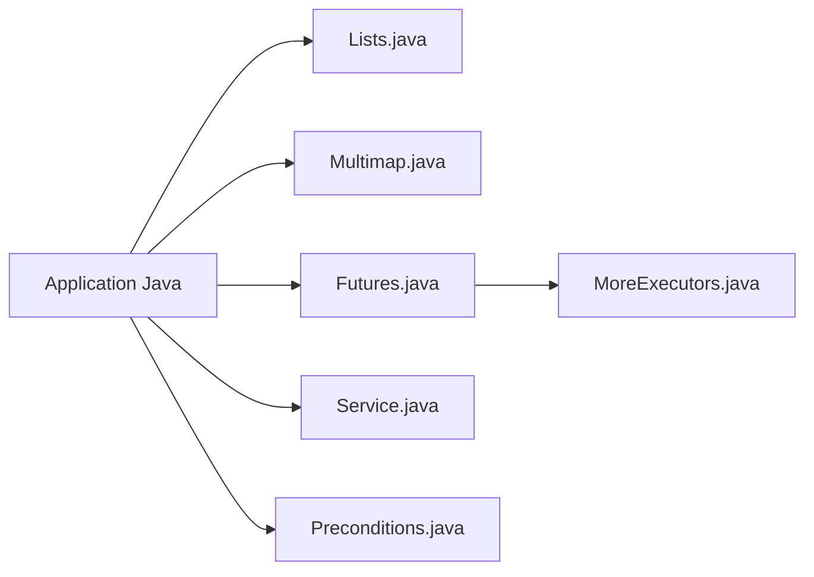

# google/guava

> Google's core Java libraries: collections, graphs, concurrency, I/O, hashing, strings.

## The problem
The base JDK lacks immutable collections, multimaps and ready-to-use concurrency utilities.

## What it actually does
Provides multimap, multiset, immutable collections, a graph library and concurrency utilities (Futures, MoreExecutors, Service, Monitor). Two flavors: JRE (JDK 8+) and Android. One runtime dependency: `failureaccess`.

## How it is wired


## Trying it
```xml
<dependency>
  <groupId>com.google.guava</groupId>
  <artifactId>guava</artifactId>
  <version>33.7.2-jre</version>
</dependency>
```

## Cost and gotchas
Free. `@Beta` APIs may change or disappear. Serialized forms are not stable from one version to the next. Not designed to withstand a malicious caller.

## What it is not
Not a framework: a toolbox. No link with data science.

## Alternatives
No alternative named in the README.

## For you
Ignore unless you code in Java/Scala: it is already pulled in as a transitive dependency by many JVM tools.
