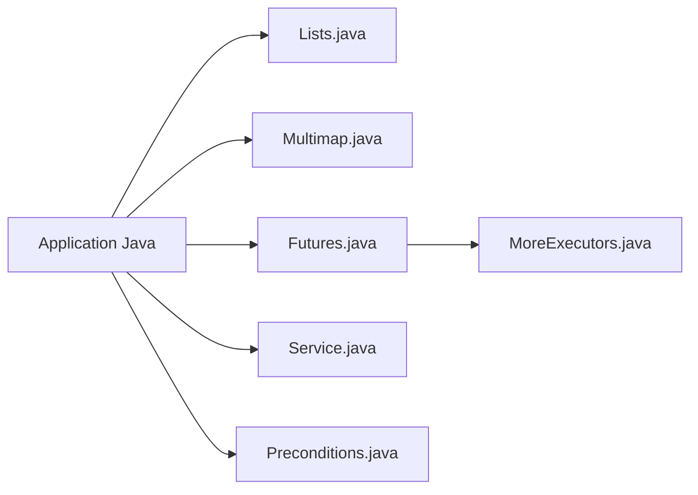

# google/guava

> Bibliothèques Java de base de Google : collections, graphes, concurrence, E/S, hachage, chaînes.

## Le problème
Le JDK de base manque de collections immuables, de multimaps et d'utilitaires de concurrence prêts à l'emploi.

## Ce que ça fait vraiment
Fournit multimap, multiset, collections immuables, une bibliothèque de graphes et des utilitaires de concurrence (Futures, MoreExecutors, Service, Monitor). Deux variantes : JRE (JDK 8+) et Android. Une dépendance runtime : `failureaccess`.

## Comment c'est branché


## Essayer
```xml
<dependency>
  <groupId>com.google.guava</groupId>
  <artifactId>guava</artifactId>
  <version>33.7.2-jre</version>
</dependency>
```

## Coût et pièges
Gratuit. Les API `@Beta` peuvent changer ou disparaître. Les formes sérialisées ne sont pas stables d'une version à l'autre. Pas conçu contre un appelant malveillant.

## Ce que ce n'est pas
Pas un framework : une boîte à outils. Aucun lien avec la data science.

## Alternatives
Aucune alternative nommée dans le README.

## Pour toi
À ignorer sauf si tu codes en Java/Scala : il est déjà tiré en dépendance transitive par de nombreux outils JVM.

