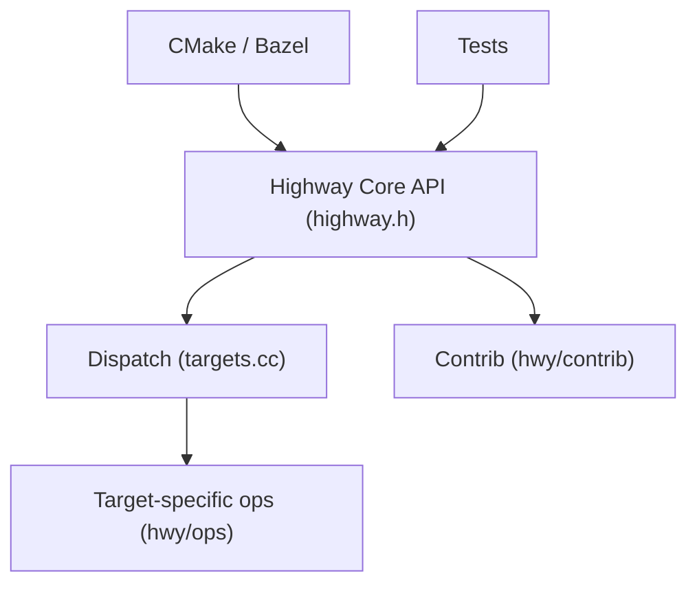

# google/highway

> C++ library of portable SIMD intrinsics, for engineers optimising code across several CPUs.

## The problem
Writing vector code for each instruction set (SSE, AVX, NEON, SVE, RVV) is costly and fragile.

## What it actually does
A set of operations that map to CPU instructions, with static or dynamic dispatch chosen at runtime. Supports 27 targets across x86, Arm, POWER, RISC-V, WebAssembly, IBM Z, LoongArch. The contrib folder adds sorting, dot product, math and an image class.

## How it is wired


## Trying it
```bash
mkdir -p build && cd build
cmake ..
make -j && make test
vcpkg install highway
```

## Cost and gotchas
Free. C++17, CMake, googletest downloaded at configuration time. Dual Apache 2 / BSD-3 licence according to the README, but not identified by GitHub. 32-bit x86 is not officially supported.

## What it is not
Not an official Google product. Not a ready-to-use linear algebra library.

## Alternatives
xSIMD (higher-level interface, fewer operations), SIMDe (emulates existing intrinsics), NumKong.

## For you
Worth watching: interesting if you write C++ compute kernels, but already embedded indirectly through TensorFlow, NumPy or ScaNN.
