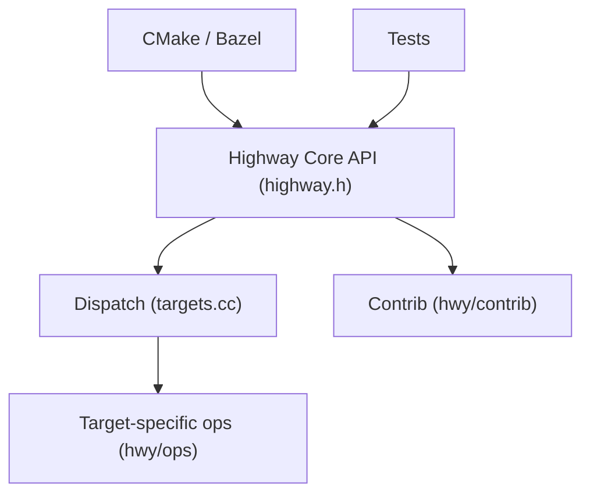

# google/highway

> Bibliothèque C++ d'intrinsèques SIMD portables, pour ingénieurs qui optimisent du code sur plusieurs CPU.

## Le problème
Écrire du code vectoriel pour chaque jeu d'instructions (SSE, AVX, NEON, SVE, RVV) est coûteux et fragile.

## Ce que ça fait vraiment
Un jeu d'opérations qui correspondent aux instructions CPU, avec dispatch statique ou dynamique choisi à l'exécution. Prend en charge 27 cibles sur x86, Arm, POWER, RISC-V, WebAssembly, IBM Z, LoongArch. Le dossier contrib ajoute tri, produit scalaire, maths et classe image.

## Comment c'est branché


## Essayer
```bash
mkdir -p build && cd build
cmake ..
make -j && make test
vcpkg install highway
```

## Coût et pièges
Gratuit. C++17, CMake, googletest téléchargé à la configuration. Licence double Apache 2 / BSD-3 selon le README, mais non identifiée par GitHub. x86 32 bits non officiellement pris en charge.

## Ce que ce n'est pas
Pas un produit Google officiel. Pas une bibliothèque d'algèbre linéaire prête à l'emploi.

## Alternatives
xSIMD (interface plus haut niveau, moins d'opérations), SIMDe (émule des intrinsèques existants), NumKong.

## Pour toi
Surveiller : intéressant si tu écris des noyaux C++ de calcul, mais déjà embarqué indirectement via TensorFlow, NumPy ou ScaNN.

