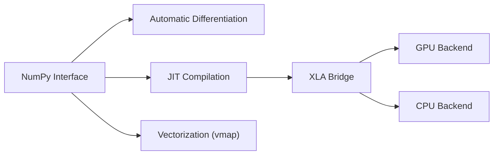

# google/jax

> Python numerical computing library with automatic differentiation and XLA compilation, for research and large-scale ML.

## The problem
Writing differentiable, compiled and parallelized NumPy computation on GPU/TPU ordinarily requires heavy frameworks.

## What it actually does
Offers a NumPy-like API and composable transformations: `grad` (derivatives of any order, forward or reverse mode), `jit` (XLA compilation), `vmap` (vectorization) and multi-device partitioning (automatic, explicit or manual per device). Runs on CPU, NVIDIA/AMD GPU, TPU. The README presents it as a research project, not an official Google product, with "sharp edges".

## How it is wired


## Trying it
```bash
pip install -U jax
pip install -U "jax[cuda13]"
pip install -U "jax[tpu]"
```

## Cost and gotchas
Free; wheels depend on the platform (CUDA 13, TPU, ROCm). The README points to a "gotchas" page: pure functions and control-flow constraints under `jit`. License not filled in in the catalog.

## What it is not
Not a neural network framework: the README does not mention layers (Flax and Optax are separate libraries). Different from PyTorch through its pure functions.

## Alternatives
No alternative named in the README.

## For you
Adopt if you do research or differentiable high-performance computing, notably on TPU; for everyday deep learning, PyTorch remains more direct.
