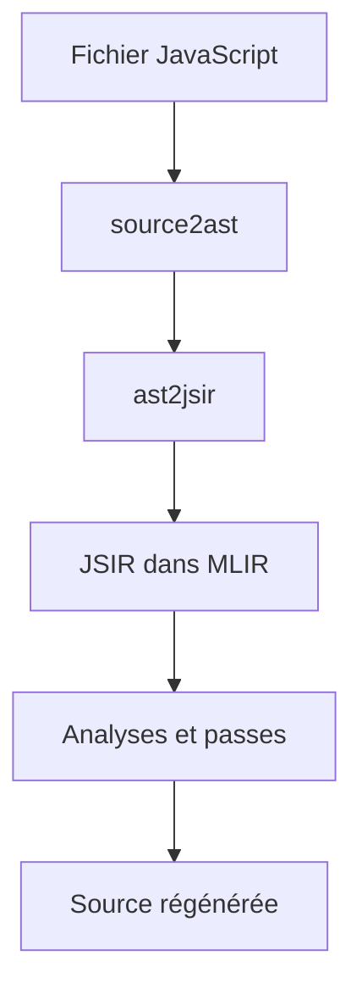

# google/jsir

> MLIR intermediate representation to analyze, transform and deobfuscate JavaScript, for code security researchers.

## The problem
Analyzing JavaScript requires a level high enough to convert back to source and low enough for data-flow analysis.

## What it actually does
Defines a high-level IR based on MLIR regions, which models control flow and converts back to code losslessly. Google uses it to decompile Hermes bytecode and deobfuscate JavaScript, including with the Gemini LLM (CASCADE paper).

## How it is wired
Simplified diagram based on the sheet, no diagram provided.



## Trying it
```bash
docker build -t jsir:latest .
docker run --rm jsir:latest jsir_gen --help
docker run --rm -v $(pwd):/workspace jsir:latest jsir_gen --input_file=/workspace/yourfile.js
```

## Cost and gotchas
Free. Bazel build tested only with clang on Linux, very disk-hungry, with a long LLVM download and compilation.

## What it is not
Not an official Google product (README note) nor a turnkey tool for the general public.

## Alternatives
No alternative named in the README.

## For you
Worth watching: the IR plus LLM combination for deobfuscation is instructive, but direct use is niche.
