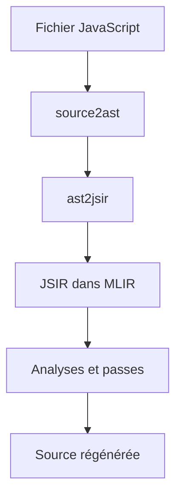

# google/jsir

> Représentation intermédiaire MLIR pour analyser, transformer et dé-obfusquer du JavaScript, pour chercheurs en sécurité du code.

## Le problème
Analyser du JavaScript demande à la fois un niveau assez haut pour le reconvertir en source et assez bas pour faire de l'analyse de flux de données.

## Ce que ça fait vraiment
Définit une IR de haut niveau fondée sur les régions MLIR, qui modélise le contrôle de flux et se reconvertit sans perte en code. Google l'utilise pour décompiler du bytecode Hermes et dé-obfusquer du JavaScript, y compris avec le LLM Gemini (article CASCADE).

## Comment c'est branché
Schéma simplifié d'après la fiche, sans diagramme fourni.



## Essayer
```bash
docker build -t jsir:latest .
docker run --rm jsir:latest jsir_gen --help
docker run --rm -v $(pwd):/workspace jsir:latest jsir_gen --input_file=/workspace/yourfile.js
```

## Coût et pièges
Gratuit. Build Bazel testé seulement avec clang sous Linux, très gourmand en disque, avec un téléchargement et une compilation de LLVM longs.

## Ce que ce n'est pas
Pas un produit Google officiel (mention du README) ni un outil clé en main pour le grand public.

## Alternatives
Aucune alternative nommée dans le README.

## Pour toi
À surveiller : la combinaison IR plus LLM pour dé-obfusquer est instructive, mais l'usage direct est de niche.

