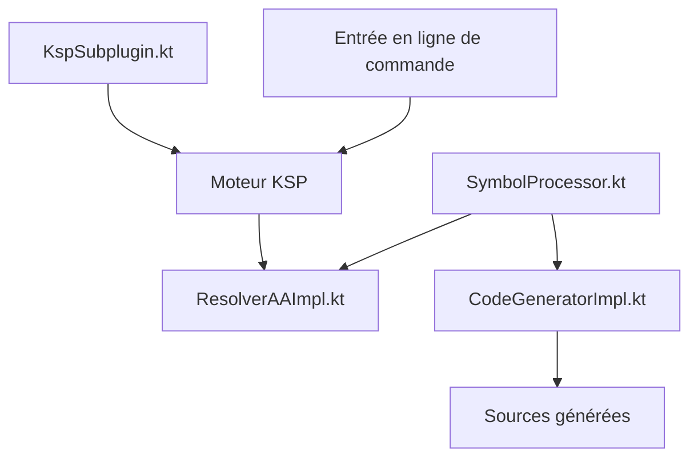

# google/ksp

> Kotlin compiler plugin API for writing annotation processors, faster than KAPT.

## The problem
Kotlin annotation processors via KAPT go through Java stubs and slow down compilations.

## What it actually does
KSP provides a simplified API to analyze Kotlin symbols and generate code. A Gradle plugin or a command line launches the engine, a resolver exposes the symbols, a generator writes the sources. Incremental processing is supported; KSP1 has been removed.

## How it is wired


## Trying it
No installation command in the README: you declare the processor in `build.gradle.kts`.
```kotlin
dependencies { ksp("com.example:processor:1.0") }
```

## Cost and gotchas
Free. A Kotlin Gradle build (JVM) is required; configuration varies across JVM, Android and multiplatform, and the global `ksp` configuration is deprecated in KMP.

## What it is not
Not a tool for end users: it is meant for library authors. Nor is it a full compiler.

## Alternatives
- KAPT: older, claimed to be up to 2 times slower.

## For you
Ignore: unless you write Kotlin or Android, it has no use in a data or MLOps pipeline.
