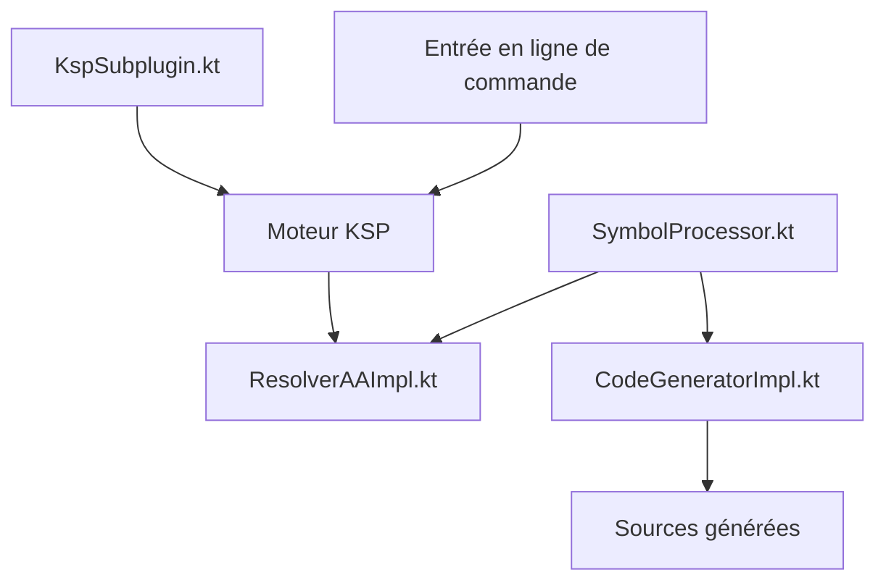

# google/ksp

> API de plugins de compilateur Kotlin pour écrire des processeurs d'annotations, plus rapide que KAPT.

## Le problème
Les processeurs d'annotations Kotlin via KAPT passent par des stubs Java et ralentissent les compilations.

## Ce que ça fait vraiment
KSP fournit une API simplifiée pour analyser les symboles Kotlin et générer du code. Un plugin Gradle ou une ligne de commande lance le moteur, un resolver expose les symboles, un générateur écrit les sources. Le traitement incrémental est géré ; KSP1 a été retiré.

## Comment c'est branché


## Essayer
Aucune commande d'installation dans le README : on déclare le processeur dans `build.gradle.kts`.
```kotlin
dependencies { ksp("com.example:processor:1.0") }
```

## Coût et pièges
Gratuit. Il faut un build Gradle Kotlin (JVM) ; la configuration varie selon JVM, Android et multiplateforme, et la configuration `ksp` globale est dépréciée en KMP.

## Ce que ce n'est pas
Pas un outil pour utilisateurs finaux : il sert aux auteurs de bibliothèques. Pas non plus un compilateur complet.

## Alternatives
- KAPT : plus ancien, annoncé jusqu'à 2 fois plus lent.

## Pour toi
Ignorer : sauf si tu écris du Kotlin ou de l'Android, il n'a aucun usage dans une chaîne data ou MLOps.

