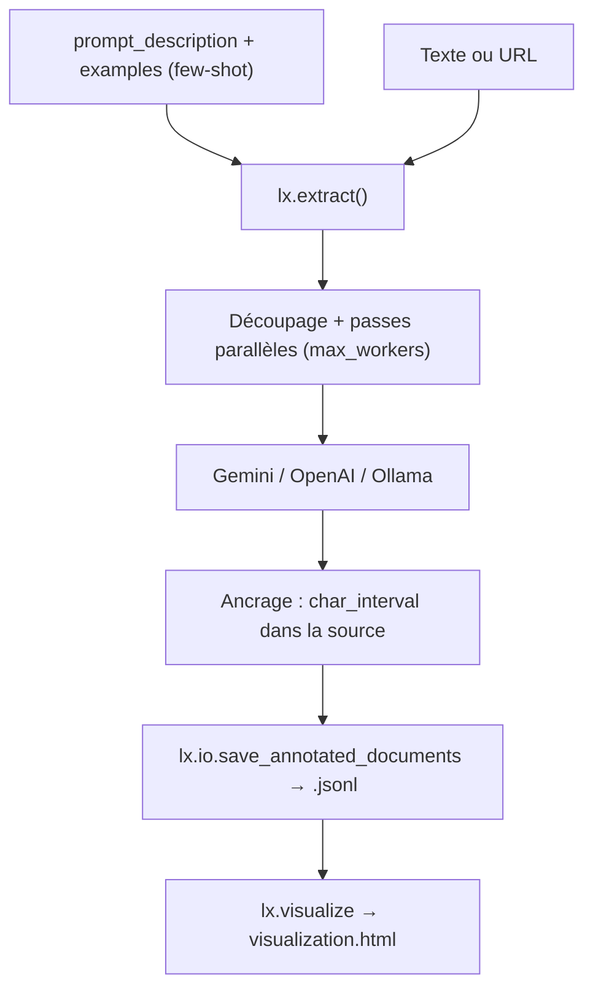

# google/langextract

> Python library that extracts structured data from text, with every extraction grounded.

## The problem
An LLM extracting entities from a report invents wordings and does not say where it
found what — impossible to verify without rereading the whole document.

## What it actually does
Maps each extraction to its exact position in the source text, which lets you highlight and
verify it. Extractions that cannot be located have `char_interval = None` and can be filtered out.
Enforces a consistent output schema derived from the few-shot examples, with controlled generation on the
models that support it; `output_schema` additionally allows constraints (enumerations) on Gemini
and OpenAI. Splits long documents, processes them in parallel and makes several passes to
improve recall — the README shows a whole novel processed from a Gutenberg URL.
Generates a standalone interactive HTML file to review thousands of entities in their context.

## How it is wired


## Trying it
```bash
pip install langextract
export LANGEXTRACT_API_KEY="your-api-key-here"
docker build -t langextract .
docker run --rm -e LANGEXTRACT_API_KEY="your-api-key" langextract python your_script.py
pytest tests
```

## Cost and gotchas
Hosted models require a key; the README recommends a paid Gemini tier for volume, because of
rate limits. Gemini models have retirement dates, to keep an eye on.
Ollama avoids the key but not the hardware, and does not support `output_schema`.
The examples drive all the behavior: a non-verbatim `extraction_text` triggers an
alignment warning that must be dealt with.

## What it is not
It is not an officially supported Google product, as the README says. It is not a medical
tool: the medication example carries an explicit warning. It is not an annotation
system: it extracts, it handles neither human review nor the correction cycle.

## Alternatives
No alternative named in the README.

## For you
The tool to reach for whenever an extraction must be verifiable line by line — reports, records.
