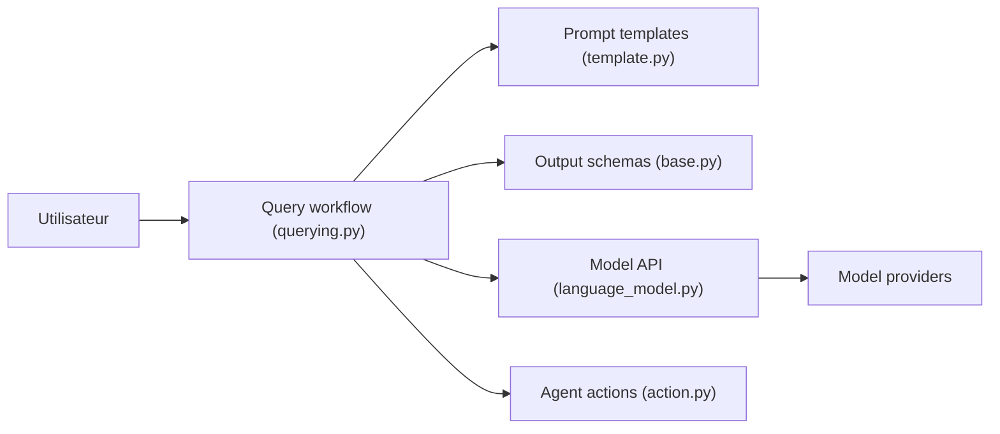

# google/langfun

> Python library, built on PyGlove, for querying LLMs with typed objects rather than text.

## The problem
Extracting structured data from an LLM means fiddling with prompts and parsing free-form answers.

## What it actually does
`lf.query` takes a prompt template, a PyGlove object schema and a model, then returns a typed object. It handles multimodal inputs, several providers (Gemini, GPT, Claude, Llama), an evaluation framework, agent actions, MCP clients and sandbox environments. The README states that this is not an officially supported Google product.

## How it is wired


## Trying it
```bash
pip install langfun
pip install langfun[all]
```

## Cost and gotchas
Free; model calls are billed by the chosen provider. You have to adopt PyGlove, a programming model of its own.

## What it is not
Not a full orchestration framework. The README's claims about simplicity are not measured.

## Alternatives
No alternative named in the README.

## For you
Worth watching: interesting for typed structured output and evaluation, but PyGlove adds a learning curve and support is unofficial.
