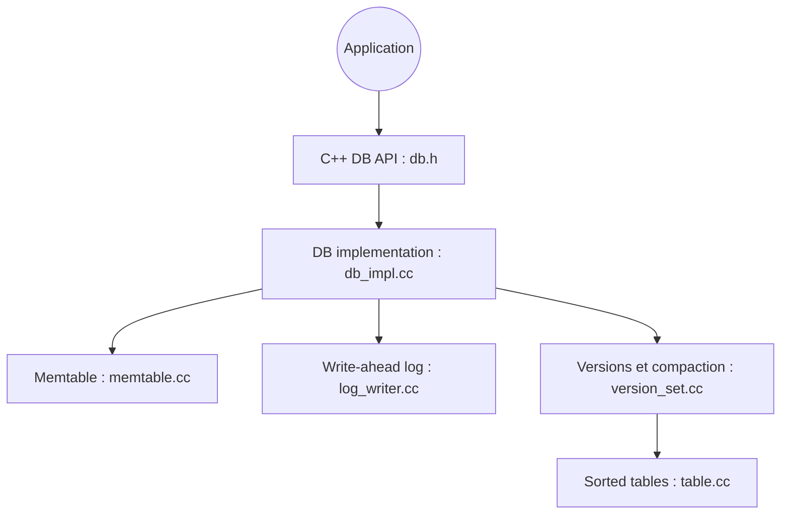

# google/leveldb

> C++ library for ordered key-value storage, embedded in a program, for developers.

## The problem
Storing sorted key-value pairs on disk, without running a database server, calls for an embedded building block.

## What it actually does
Offers Put, Get, Delete, atomic batches, snapshots and forward and backward iteration. Writes go through a log and a memtable, then sorted files compacted in the background. Snappy compression, Zstd possible. System operations go through a replaceable interface.

## How it is wired


## Trying it
```bash
git clone --recurse-submodules https://github.com/google/leveldb.git
mkdir -p build && cd build
cmake -DCMAKE_BUILD_TYPE=Release .. && cmake --build .
```

## Cost and gotchas
Free; built with CMake. Only one process can access the database at a time. The repository receives very limited maintenance (critical fixes only). The performance figures date from 2011.

## What it is not
Not a SQL database: no indexes or queries. No built-in client-server layer.

## Alternatives
No alternative named in the README.

## For you
Watch: an embedded building block worth understanding (it underpins other tools), but in minimal maintenance, so not to be chosen for a new project without a reason.
