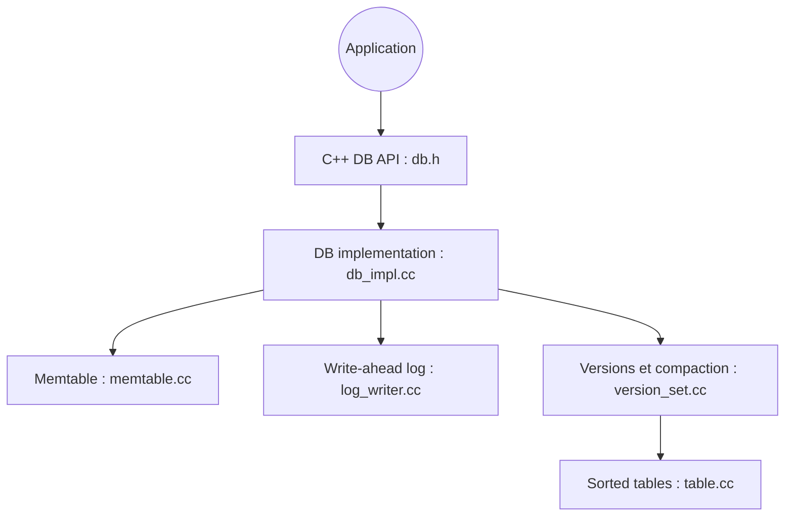

# google/leveldb

> Bibliothèque C++ de stockage clé-valeur ordonné, intégrée à un programme, pour développeurs.

## Le problème
Stocker des paires clé-valeur triées sur disque, sans lancer un serveur de base de données, demande une brique embarquée.

## Ce que ça fait vraiment
Offre Put, Get, Delete, lots atomiques, instantanés et itération avant et arrière. Les écritures passent par un journal et une memtable, puis des fichiers triés compactés en arrière-plan. Compression Snappy, Zstd possible. Les opérations système passent par une interface remplaçable.

## Comment c'est branché


## Essayer
```bash
git clone --recurse-submodules https://github.com/google/leveldb.git
mkdir -p build && cd build
cmake -DCMAKE_BUILD_TYPE=Release .. && cmake --build .
```

## Coût et pièges
Gratuit ; compilation avec CMake. Un seul processus accède à la base à la fois. Le dépôt reçoit une maintenance très limitée (correctifs critiques seulement). Les chiffres de performance datent de 2011.

## Ce que ce n'est pas
Pas une base SQL : ni index ni requêtes. Pas de serveur client-serveur intégré.

## Alternatives
Aucune alternative nommée dans le README.

## Pour toi
À surveiller : brique embarquée utile à comprendre (elle sert de base à d'autres outils), mais en maintenance minimale, donc à ne pas choisir pour un nouveau projet sans raison.

