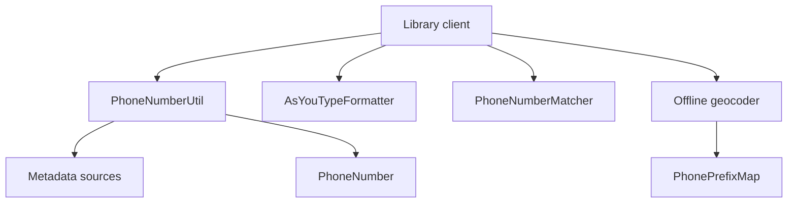

# google/libphonenumber

> Java, C++ and JavaScript library to parse, format and validate international phone numbers.

## The problem
Phone numbers vary by country; validating or normalizing them by hand gives wrong results.

## What it actually does
`PhoneNumberUtil` parses, validates and formats (E164, international, national). Provides the number type, an "as you type" formatter, searching for numbers in text, offline geocoding, the originating carrier and time zones. Metadata is loaded at runtime.

## How it is wired
Diagram based on the code diagram, simplified.



## Trying it
```java
PhoneNumberUtil phoneUtil = PhoneNumberUtil.getInstance();
PhoneNumber swissNumberProto = phoneUtil.parse("044 668 18 00", "CH");
boolean isValid = phoneUtil.isValidNumber(swissNumberProto);
```
Jars on the Maven repository; online JavaScript demo.

## Cost and gotchas
Free. The README notes that the Java demo lags behind the library (v9.0.43 versus v8.12.57). Java in practice, absent from the prerequisites. The carriers given are the original ones, not current ones (portability).

## What it is not
Does not tell whether a number is actually assigned or reachable. Not an online service. Third-party ports (including Python) are not maintained by the project.

## Alternatives
- python-phonenumbers: Python port cited in the README.
- libphonenumber-js: lightweight rewrite (~110 KB) for JavaScript.
- libphonenumber-android (MichaelRocks): suited to Android constraints.

## For you
Worth watching: useful for normalizing numbers in datasets, via the Python port, rather than this Java version.
