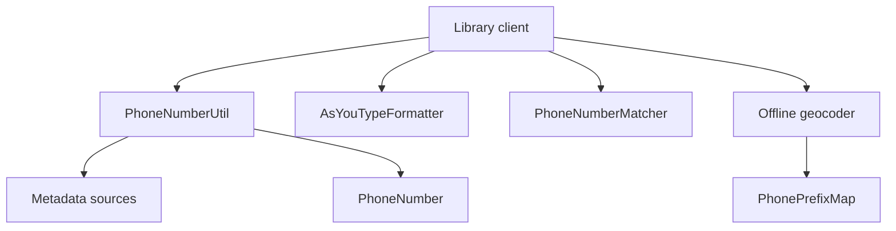

# google/libphonenumber

> Bibliothèque Java, C++ et JavaScript pour analyser, formater et valider des numéros de téléphone internationaux.

## Le problème
Les numéros de téléphone varient selon les pays ; les valider ou les normaliser à la main donne des résultats faux.

## Ce que ça fait vraiment
`PhoneNumberUtil` analyse, valide et formate (E164, international, national). Fournit le type de numéro, un formateur « à la frappe », la recherche de numéros dans un texte, le géocodage hors ligne, l'opérateur d'origine et les fuseaux horaires. Les métadonnées sont chargées à l'exécution.

## Comment c'est branché
Schéma d'après le diagramme du code, simplifié.



## Essayer
```java
PhoneNumberUtil phoneUtil = PhoneNumberUtil.getInstance();
PhoneNumber swissNumberProto = phoneUtil.parse("044 668 18 00", "CH");
boolean isValid = phoneUtil.isValidNumber(swissNumberProto);
```
Jars sur le dépôt Maven ; démo JavaScript en ligne.

## Coût et pièges
Gratuit. Le README signale que la démo Java est en retard sur la bibliothèque (v9.0.43 contre v8.12.57). Java en pratique, absent des prérequis. Les opérateurs donnés sont d'origine, pas actuels (portabilité).

## Ce que ce n'est pas
Ne dit pas si un numéro est réellement attribué ou joignable. Pas un service en ligne. Les ports tiers (dont Python) ne sont pas maintenus par le projet.

## Alternatives
- python-phonenumbers : port Python cité dans le README.
- libphonenumber-js : réécriture allégée (~110 Ko) pour le JavaScript.
- libphonenumber-android (MichaelRocks) : adapté aux contraintes Android.

## Pour toi
À surveiller : utile pour normaliser des numéros dans des jeux de données, via le port Python, plutôt que cette version Java.

