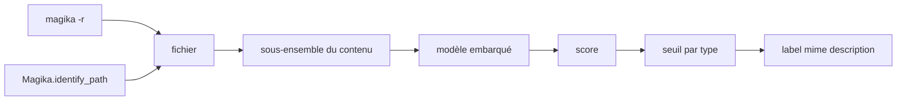

# google/magika

> Neural-network file type detector, accurate on more than 200 content types.

## The problem
`file` and magic signatures are often wrong, especially on text content and code.
A wrong type at the start of a pipeline means a crashing parser or a misrouted file.

## What it actually does
A model of a few MB, trained on ~100M files, ~99% average precision and recall on their test set.
About 5 ms per file after the model is loaded, even on a single CPU, almost independent of file size.
A per-content-type threshold decides whether to trust the prediction or return a generic label.
Three tolerance modes: `high-confidence`, `medium-confidence`, `best-guess`.

## How it is wired


## Trying it
```bash
pipx install magika
magika -r * | head
magika ./tests_data/basic/python/code.py --json
cat tests_data/basic/ini/doc.ini | magika -
```
Also `brew install magika`, `cargo install --locked magika-cli`, `pip install magika`, `npm install magika`.

## Cost and gotchas
Nothing to pay or host: the model is embedded and inference is local.
The threshold may return "Generic text document" or "Unknown binary data" — that is a refusal, not an error.

## What it is not
Not an official Google project: the README disclaims any guarantee of quality or fitness.
Not an antivirus: it identifies a content type, it does not judge danger.
Not a certainty: ~99% on average means errors, hence the confidence modes.

## Alternatives
None named in the README.

## For you
Put it at the entry of every document ingestion pipeline: 5 ms to avoid a wrongly chosen parser.
