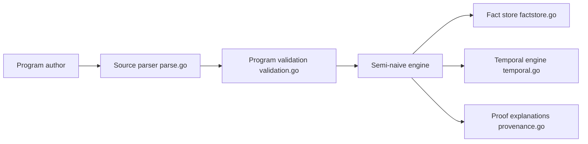

# google/mangle

> Deductive programming language (extended Datalog) in Go, embeddable, for reasoning over heterogeneous data.

## The problem
Joining data sources and modeling knowledge with recursive rules is awkward in SQL.

## What it actually does
A Go implementation of Datalog with aggregation, function calls, optional typing and temporal reasoning (facts with intervals). Pipeline: source parsing, rule validation and analysis, semi-naive bottom-up evaluation against a fact store, queries and proof explanations. An interactive interpreter exists. Termination is no longer guaranteed with the extensions.

## How it is wired


## Trying it
```bash
go get -t ./...
go build ./...
go test ./...
```

## Cost and gotchas
Go required, plus Java and ANTLR 4.13.2 only to regenerate the parser. The repository is hosted on Codeberg with a GitHub mirror.

## What it is not
Is not, and has never been, an officially supported Google product (stated in the README). Not a server database: a library to embed.

## Alternatives
- Logica: translates non-recursive Datalog into SQL.

## For you
Worth watching: relevant for symbolic reasoning or a knowledge graph, but niche; no direct link with a classic ML pipeline.
