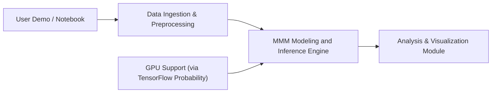

# google/meridian

> Bayesian marketing mix modeling framework to measure the return of each channel, to run in-house.

## The problem
Knowing which advertising channel actually drove sales, and where to reallocate budget, without individual data or cookies.

## What it actually does
Estimates the effect of channels on a KPI through Bayesian causal inference (NUTS sampler, TensorFlow Probability), on data aggregated by geographic area or national data. Computes ROI, optimizes the budget, allows calibration with experiments and frequency optimization using reach & frequency data. HTML reports from Jinja2 templates. Migration guide from LightweightMMM.

## How it is wired


## Trying it
```sh
pip install --upgrade google-meridian[and-cuda]
pip install --upgrade google-meridian
```
The README points to the "Getting Started" Colab with sample data.

## Cost and gotchas
Python 3.11–3.13; at least one GPU recommended (tested on a T4 with 16 GB) because MCMC sampling is heavy. No official GPU support on macOS.

## What it is not
Not a user-level attribution tool. Results depend on the quality of the aggregated data.

## Alternatives
LightweightMMM, for which the README provides the migration guide.

## For you
Adopt: a documented Bayesian modeling framework, maintained by Google, directly useful to a data scientist in marketing analytics.
