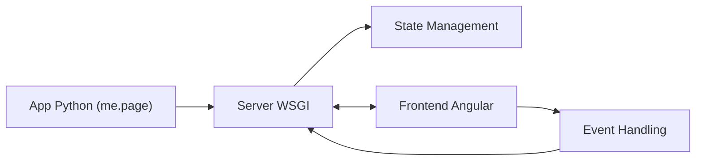

# google/mesop

> Python framework for building demos and internal web applications without writing JavaScript.

## The problem
Building a web interface for an ML demo forces you to touch HTML, CSS and JavaScript.

## What it actually does
You write the interface as Python functions (`@me.page`), with ready-made components, hot reload that preserves state, and strict typing. The code describes an Angular frontend, a WSGI server, session state management and a security policy. A `mesop.labs` component provides text-to-text style examples.

## How it is wired


## Trying it
```bash
pip install mesop
mesop main.py
```

## Cost and gotchas
Free. **Major warning**: the README announces that Mesop will no longer be maintained from September 30, 2026 (no more fixes or support). "Not an officially supported Google product."

## What it is not
Not a lasting framework: end of maintenance announced. Does not replace a real frontend.

## Alternatives
None named in the README.

## For you
To ignore for a new project: maintenance stops the day after this reading, so a living tool is better for your demos.
