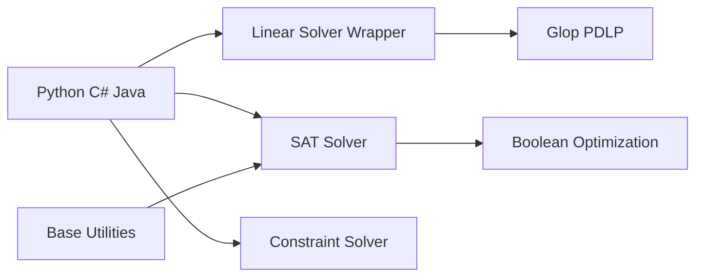

# google/or-tools

> Google's combinatorial optimization suite: CP-SAT, linear programming, routing, graphs.

## The problem
Solve assignment, scheduling, routing or flow problems without writing a solver.

## What it actually does
C++ code with Python, C# and Java wrappers (and Julia, Go depending on the graph). CP-SAT and CP solvers, Glop (simplex) and PDLP (first-order), an abstraction layer over third-party mixed-integer solvers, and algorithms for knapsack, traveling salesman, vehicle routing, shortest paths and flows.

## How it is wired

## Trying it
No install command in the README (it points to the site developers.google.com/optimization). It can be built with Make, CMake or Bazel.

## Cost and gotchas
Free. The wrappers to commercial solvers assume licenses at your own expense. The tested platform versions cited are old.

## What it is not
Not machine learning: it is exact and heuristic optimization on formalized models.

## Alternatives
No alternative named in the README.

## For you
Adopt it for planning, allocation or routing in MLOps (scheduling, assignment): an Apache-2.0 reference, well documented.
