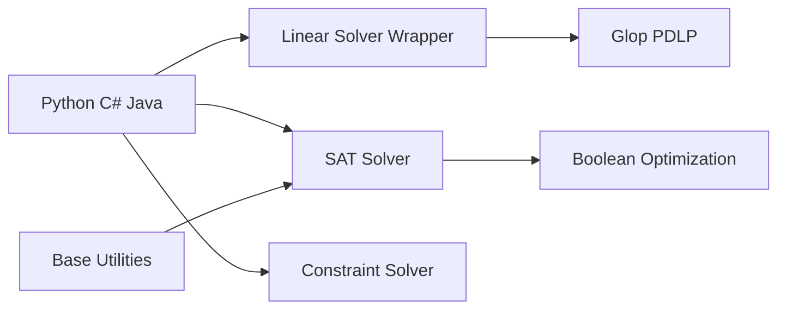

# google/or-tools

> Suite d'optimisation combinatoire de Google : CP-SAT, programmation linéaire, routage, graphes.

## Le problème
Résoudre des problèmes d'affectation, de planification, de tournées ou de flots sans écrire un solveur.

## Ce que ça fait vraiment
Code C++ avec wrappers Python, C#, Java (et Julia, Go selon le graphe). Solveurs CP-SAT et CP, Glop (simplexe) et PDLP (premier ordre), couche d'abstraction vers solveurs mixtes tiers, algorithmes de sac à dos, voyageur de commerce, tournées de véhicules, plus courts chemins, flots.

## Comment c'est branché

## Essayer
Aucune commande d'installation dans le README (renvoi au site developers.google.com/optimization). Compilation possible avec Make, CMake ou Bazel.

## Coût et pièges
Gratuit. Les wrappers vers solveurs commerciaux supposent des licences à ta charge. Les versions de plateformes testées citées sont anciennes.

## Ce que ce n'est pas
Pas du machine learning : c'est de l'optimisation exacte et heuristique sur modèles formalisés.

## Alternatives
Aucune alternative nommée dans le README.

## Pour toi
Adopter pour planification, allocation ou tournées en MLOps (ordonnancement, affectation) : référence Apache-2.0, bien documentée.

