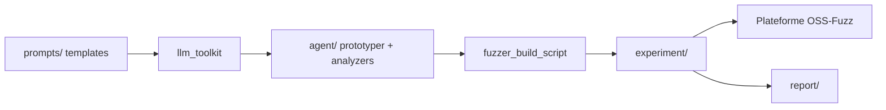

# google/oss-fuzz-gen

> Framework that generates fuzz targets with an LLM for C, C++, Java and Python projects, and evaluates them via OSS-Fuzz.

## The problem
Hand-writing fuzzing harnesses for hundreds of libraries leaves code uncovered.

## What it actually does
It has models (Vertex AI, Gemini, GPT-4 and derivatives, Azure) produce fuzz targets, compiles them and evaluates them on four criteria: compilability, crashes, coverage, and coverage gap against human-written targets. The team reports 30 vulnerabilities found (including CVE-2024-9143 in OpenSSL) and per-project coverage gains. Individual agents can be run on their own.

## How it is wired

## Trying it
No command documented in the README: it points to the detailed usage guide and to the agent execution documentation.

## Cost and gotchas
LLM calls are at your expense (Vertex AI or OpenAI). Full reports are not public, as they may contain undisclosed vulnerabilities. The README's list of models is dated (code-bison, GPT-3.5).

## What it is not
Not a turnkey tool: it is a research framework tied to OSS-Fuzz. The last push dates from March 2026.

## Alternatives
No alternative named in the README.

## For you
Keep an eye on it: a textbook case of evaluating LLM-generated code with objective metrics, worth reading for its methods.
