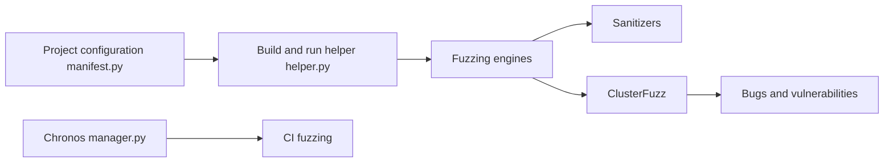

# google/oss-fuzz

> Google's continuous fuzzing service for open source projects, to detect bugs and security flaws.

## The problem
Memory errors and other rare bugs slip past classic tests; open source projects lack the infrastructure to fuzz at large scale.

## What it actually does
A project provides fuzz targets; OSS-Fuzz builds them with libFuzzer, AFL++ or Honggfuzz and sanitizers, runs them in a distributed way through ClusterFuzz and reports the bugs found. Languages: C/C++, Rust, Go, Python, Java/JVM, JavaScript, Lua. According to the README, more than 13,000 vulnerabilities and 50,000 bugs fixed across 1,000 projects (May 2025).

## How it is wired

## Trying it
No command in the README: it points to the detailed documentation (google.github.io/oss-fuzz).

## Cost and gotchas
Free for accepted projects. Closed projects must host their own ClusterFuzz or ClusterFuzzLite. Supports x86_64 and i386.

## What it is not
Not a tool to run locally on any code: it is a service with project admission. It detects bugs, it does not fix them. Defensive use, on code you maintain.

## Alternatives
- ClusterFuzzLite: for ineligible projects or fuzzing in CI.
- ClusterFuzz: to host your own instance.

## For you
Keep an eye on it: relevant if you publish an open source Python or C/C++ library; otherwise irrelevant for typical data / AI use.
