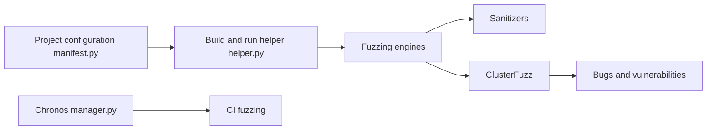

# google/oss-fuzz

> Service de fuzzing continu de Google pour projets open source, afin de détecter bugs et failles de sécurité.

## Le problème
Les erreurs mémoire et autres bugs rares passent les tests classiques ; les projets open source n'ont pas l'infrastructure pour fuzzer à grande échelle.

## Ce que ça fait vraiment
Un projet fournit des cibles de fuzzing ; OSS-Fuzz les compile avec libFuzzer, AFL++ ou Honggfuzz et des sanitizers, les exécute de façon distribuée via ClusterFuzz et signale les bugs trouvés. Langages : C/C++, Rust, Go, Python, Java/JVM, JavaScript, Lua. Selon le README, plus de 13 000 vulnérabilités et 50 000 bugs corrigés sur 1 000 projets (mai 2025).

## Comment c'est branché

## Essayer
Aucune commande dans le README : il renvoie à la documentation détaillée (google.github.io/oss-fuzz).

## Coût et pièges
Gratuit pour les projets acceptés. Les projets fermés doivent héberger leur propre ClusterFuzz ou ClusterFuzzLite. Supporte x86_64 et i386.

## Ce que ce n'est pas
Ce n'est pas un outil à lancer en local sur n'importe quel code : c'est un service avec admission des projets. Il détecte des bugs, il ne les corrige pas. Usage défensif, sur du code dont tu es mainteneur.

## Alternatives
- ClusterFuzzLite : pour projets non éligibles ou fuzzing en CI.
- ClusterFuzz : pour héberger ta propre instance.

## Pour toi
À surveiller : pertinent si tu publies une bibliothèque Python ou C/C++ open source ; sinon sans objet pour un usage data / IA courant.

